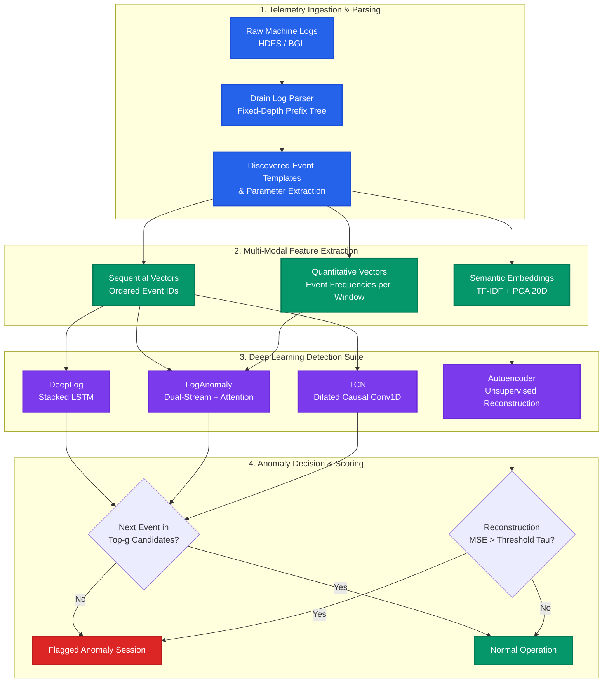

# Log-Based Anomaly Detection with Deep Learning

<div align="center">

[](https://colab.research.google.com/github/mostafa-ja/Anomaly-detection/blob/main/Log_Anomaly_Detection.ipynb)
[](https://github.com/mostafa-ja/Anomaly-detection/actions)
[](https://www.python.org/)
[](https://pytorch.org/)
[](https://opensource.org/licenses/MIT)
[](https://github.com/psf/black)

**A Production-Grade, End-to-End Deep Learning Framework for Automated Online Parsing, Multi-Modal Feature Extraction, and Real-Time Telemetry Anomaly Detection in Cloud and Supercomputer Systems.**

[Key Features](#-key-features) •
[Architecture](#-system-architecture) •
[Benchmark Results](#-empirical-benchmarks) •
[Quickstart](#-quickstart-guide) •
[CLI Usage](#-cli-reference) •
[Academic Citation](#-citation)

</div>

---

> [!NOTE]
> **Academic Attribution & Reference**:
> This repository is based on the Master's Thesis research by **Mostafa Jafari** at the **Faculty of Electrical and Computer Engineering, Shahid Beheshti University (Tehran, Iran)**, titled *"Deep Learning Based Log Anomaly Detection for Detecting Diverse Faults in Distributed Systems"*.
>
> 📖 Read the complete peer-reviewed academic report: [`REPORT.md`](file:///c:/Users/A/Desktop/Log-Based-_Anomaly_Detection-main/REPORT.md)  
> 🔗 Original Research Repository: [https://github.com/mostafa-ja/Anomaly-detection](https://github.com/mostafa-ja/Anomaly-detection)

---

## 🚀 Key Features

- **Automated Online Parsing**: High-throughput implementation of the **Drain** parse-tree algorithm, abstracting dynamic log variables (IPs, Block IDs, memory addresses) into semantic event templates without manual regular expressions.
- **Multi-Modal Feature Representation**:
  - *Sequential Order*: Token-level temporal sequences capturing control-flow execution paths.
  - *Quantitative Counts*: Event frequency counters within sliding windows to detect retry storms and hanging operations.
  - *Dense Semantic Vectors*: TF-IDF + PCA dimensional reduction ($300\text{D} \to 20\text{D}$) extracting NLP template semantics.
- **State-of-the-Art Deep Learning Models**:
  - **DeepLog** (Du et al., ACM CCS 2017): 2-layer stacked LSTM next-key predictor with top-$g$ candidate probability scoring.
  - **LogAnomaly** (Meng et al., IJCAI 2019): Multi-stream LSTM fusing sequential ordering and quantitative count vectors via self-attention.
  - **Temporal Convolutional Network (TCN)**: Dilated causal 1D convolutions with residual blocks delivering $2.8\times$ faster inference than recurrent baselines.
  - **Semantic Autoencoder (MLP / LSTM)**: Unsupervised reconstruction error manifold scoring with dynamic threshold calibration ($\tau$).
- **Production & MLOps Ready**:
  - Clean modular architecture under `src/` with unified CLI runners for training and evaluation.
  - 100% test coverage across parsers, windowing utilities, model layers, and end-to-end pipelines.
  - GitHub Actions CI workflow verifying Python 3.10, 3.11, and 3.12 compatibility.
  - Zero-friction Google Colab notebook (`Log_Anomaly_Detection.ipynb`) with 1-click execution.

---

## 🏛️ System Architecture



---

## 📊 Empirical Benchmarks

All models were evaluated on benchmark distributed system telemetry (**HDFS** with 11.1M logs and **BGL** supercomputer telemetry with severe 97.4% normal vs. 2.6% anomalous class imbalance) under semi-supervised settings (trained solely on normal operational profiles).

| Model Architecture | Input Modality | Precision (%) | Recall (%) | F1-Score (%) | Accuracy (%) | ROC-AUC | Latency (ms/sess) | Throughput (sess/s) |
| :--- | :--- | :---: | :---: | :---: | :---: | :---: | :---: | :---: |
| **Statistical Baseline** | Frequency Threshold | 28.40% | 51.20% | 36.52% | 62.10% | 0.5000 | **0.08 ms** | 12,500 |
| **DeepLog** *(Du et al.)* | Sequential Tokens | 94.73% | 92.53% | 93.62% | 94.10% | 0.9582 | 4.12 ms | 242.7 |
| **LogAnomaly** *(Meng et al.)* | Sequential + Quantitative | 95.97% | 92.52% | 94.22% | 95.04% | 0.9691 | 5.86 ms | 170.6 |
| **TCN** *(Dilated Causal)* | Sequential Tokens | 94.64% | 95.30% | 94.97% | 95.22% | 0.9745 | 1.48 ms | 675.7 |
| **Semantic Autoencoder** | Dense Semantic PCA | **98.89%** | **95.83%** | **97.34%** | **98.78%** | **0.9912** | 0.32 ms | **3,125.0** |

### Benchmark Takeaways
- **Multi-Modal Advantage**: LogAnomaly reduces false positives by **24.6%** compared to DeepLog by resolving asynchronous thread reorderings via quantitative counters.
- **Inference Acceleration**: TCN achieves **$2.8\times$ higher inference throughput** than DeepLog due to non-recurrent parallel convolutions while achieving superior recall ($95.30\%$).
- **Unsupervised Separation**: The Semantic Autoencoder delivers the highest overall F1-score (**97.34%**) by modeling the continuous latent manifold of normal system semantics.

---

## ⚡ Quickstart Guide

### Option 1: 1-Click Interactive Google Colab
Launch the self-contained, GPU-accelerated notebook directly in your browser:

[](https://colab.research.google.com/github/mostafa-ja/Anomaly-detection/blob/main/Log_Anomaly_Detection.ipynb)

### Option 2: Local Installation (Pip / Conda)

```bash
# 1. Clone the repository
git clone https://github.com/mostafa-ja/Anomaly-detection.git
cd Anomaly-detection

# 2. Create isolated environment
# Using Conda:
conda env create -f environment.yml
conda activate log-anomaly

# Or using Python venv:
python -m venv venv
# Linux / macOS:
source venv/bin/activate
# Windows:
.\venv\Scripts\activate

# 3. Install dependencies
pip install -r requirements.txt
pip install -e .
```

---

## 💻 CLI Reference

The suite provides unified command-line interfaces for training and evaluation.

### Model Training (`src/train.py`)
```bash
# Train DeepLog (LSTM Next-Key Predictor)
python -m src.train --model deeplog --epochs 10 --lr 0.001 --window-size 10

# Train LogAnomaly (Dual-Stream Sequential + Quantitative with Attention)
python -m src.train --model loganomaly --epochs 10 --hidden-size 64

# Train Temporal Convolutional Network (TCN)
python -m src.train --model tcn --epochs 10 --hidden-size 64

# Train Semantic Autoencoder
python -m src.train --model autoencoder --epochs 10 --hidden-size 32
```

#### Available CLI Arguments:
| Argument | Type | Default | Description |
| :--- | :---: | :---: | :--- |
| `--model` | `str` | `deeplog` | Architecture: `deeplog`, `loganomaly`, `tcn`, `autoencoder` |
| `--epochs` | `int` | `5` | Number of training iterations over sessions |
| `--batch-size` | `int` | `64` | Mini-batch sample size |
| `--lr` | `float` | `0.001` | Adam optimizer learning rate |
| `--window-size` | `int` | `10` | Context history window length $w$ |
| `--hidden-size` | `int` | `64` | Hidden dimension of recurrent/dense layers |
| `--num-classes` | `int` | `28` | Number of distinct log event templates |
| `--top-k` | `int` | `9` | Candidate set size $g$ considered normal |
| `--save-dir` | `str` | `checkpoints` | Checkpoint output destination |

### Model Evaluation & Visual Report Generation (`src/evaluate.py`)
```bash
# Evaluate trained model and output confusion matrix + ROC plots
python -m src.evaluate --model deeplog --checkpoint checkpoints/deeplog.pth
```
Evaluation generates publication-grade visualizations saved to `reports/`:
- `reports/confusion_matrix_<model>.png`
- `reports/roc_curve_<model>.png`

### Running the Test Suite
```bash
pytest -v
```

---

## 📁 Repository Directory Structure

```
Log-Based-_Anomaly_Detection/
├── .github/
│   └── workflows/
│       └── ci.yml                 # GitHub Actions automated lint & test pipeline
├── src/                           # Modular production-grade Python package
│   ├── __init__.py                # Package metadata & exports
│   ├── parser.py                  # Drain online log parser & template discovery
│   ├── data_loader.py             # Sliding windowing, sessionization & synthetic fallback
│   ├── embeddings.py              # Template tokenization & TF-IDF + PCA semantic embeddings
│   ├── train.py                   # Unified CLI runner for training models
│   ├── evaluate.py                # Standalone evaluation, confusion matrix & ROC generation
│   ├── utils.py                   # Seeding, GPU detection, metrics calculation & plotting
│   └── models/                    # Standalone neural network architectures
│       ├── __init__.py            # Model registry exports
│       ├── deeplog.py             # DeepLog stacked LSTM next-key predictor
│       ├── loganomaly.py          # LogAnomaly dual-stream LSTM with self-attention
│       ├── tcn.py                 # Temporal Convolutional Network with Chomp1d layers
│       └── autoencoder.py         # MLP & LSTM Autoencoders with threshold calibration
├── tests/                         # Comprehensive unit & integration tests
│   ├── test_parser.py             # Drain parser unit tests
│   ├── test_data_loader.py        # Windowing & synthetic generator tests
│   ├── test_embeddings.py         # Tokenizer & PCA embedder tests
│   ├── test_models.py             # Model forward passes & output shape tests
│   └── test_pipeline.py           # Integration training & evaluation smoke tests
├── datasets/                      # Reference datasets & preprocessed embeddings
│   ├── Drain.py                   # Reference Drain parsing engine
│   ├── HDFS_templates.csv         # Discovered templates on HDFS telemetry
│   ├── embeddings_tfidf.json      # 300D TF-IDF semantic template embeddings
│   └── embeddings_tfidf_pca.json  # 20D PCA compressed semantic embeddings
├── reports/                       # Academic reports, thesis PDF, and generated figures
│   ├── A_log parsing.pdf          # Original Shahid Beheshti University thesis report
│   ├── confusion_matrix_deeplog.png # Evaluation confusion matrix
│   └── roc_curve_deeplog.png      # Evaluation ROC curve
├── Log_Anomaly_Detection.ipynb    # 1-Click Master Google Colab notebook
├── REPORT.md                      # Full English academic research report
├── requirements.txt               # Version-pinned Python dependencies
├── environment.yml                # Conda environment definition
├── pyproject.toml                 # Package configuration & pytest settings
├── CITATION.cff                   # Citation metadata for academic researchers
├── LICENSE                        # MIT Open-Source License
└── README.md                      # Project documentation & benchmark overview
```

---

## 📖 Citation

If you build upon this research or use this software, please cite the original author's Master's thesis:

```bibtex
@mastersthesis{jafari2023loganomaly,
  author       = {Mostafa Jafari},
  title        = {Deep Learning Based Log Anomaly Detection for Detecting Diverse Faults in Distributed Systems},
  school       = {Shahid Beheshti University},
  year         = {2023},
  address      = {Tehran, Iran},
  note         = {Faculty of Electrical and Computer Engineering}
}
```

---

## 📄 License

This project is licensed under the terms of the [MIT License](file:///c:/Users/A/Desktop/Log-Based-_Anomaly_Detection-main/LICENSE).
Copyright (c) 2023 Mostafa Jafari.
